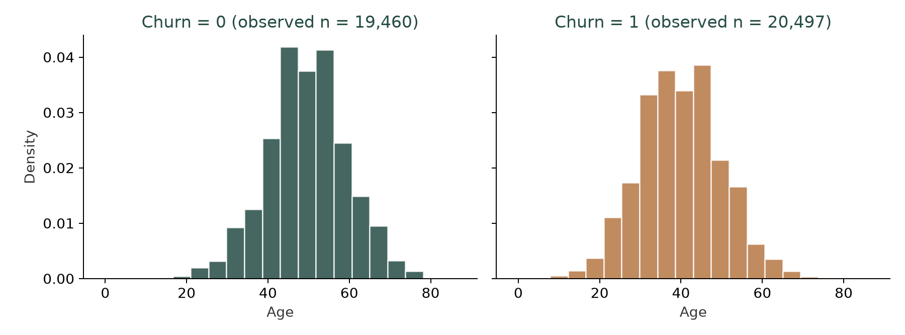
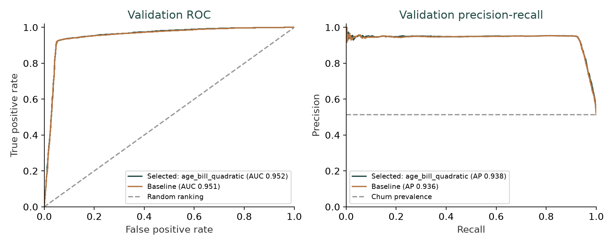
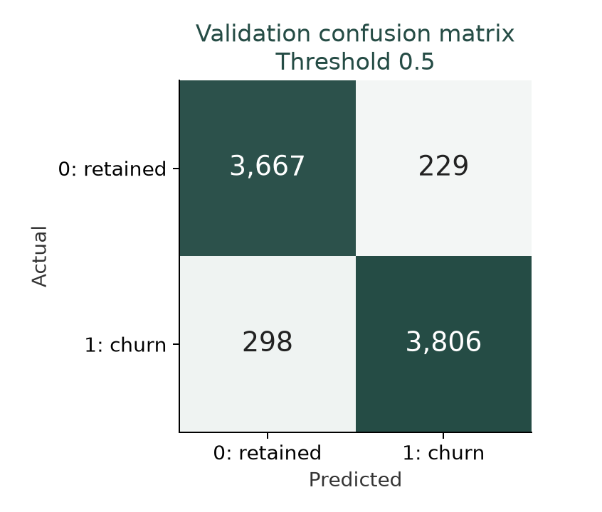

# Customer churn: logistic regression analysis

## Findings
The model selected using training-only cross-validation was **age_bill_quadratic**. On the 8,000-customer validation set, ROC AUC was **0.9525** (300-resample percentile bootstrap 95% CI 0.9474–0.9576), precision **0.9432**, recall **0.9274**, and F1 **0.9353** at probability threshold 0.5. Average precision (AP) was **0.9377**, compared with validation churn prevalence 0.5130. AP summarizes the precision-recall curve and is distinct from ROC AUC.

## Data completeness and exploration (tasks 1–4)
Source: `Mocked_Customer_Data_With_Missing.xlsx`, sheet `uscell_inputs`. The data frame contains 40,000 rows and 18 columns, with 20,522 churned customers (51.30%). churn_flag is the screenshot's churn variable, with 1 treated as churn and 0 as retained. cust_id contains unique identifiers and was excluded from the model. Binary home_owner is categorical; num_cont, tot_call and num_out are numeric counts. The original spelling marrital is retained. There are 104 missing cells across 101 records; age has 43 missing values, tot_bill 33 and fortune 28. No target values are missing and no customer IDs are repeated.

Numeric predictors: age, num_cont, tot_bill, tot_call, tot_bal, tot_bytes, tot_air, num_out, google_bytes, google_air, yahoo_bytes, yahoo_air. Categorical predictors: gender, marrital, home_owner, fortune. Units and the observation window were not supplied; no currency or time unit is assumed.

The observed mean ages are 49.51 for retained customers and 39.80 for churned customers. Histograms use identical bins and densities to permit comparison despite different group sizes. Missing ages are excluded from these descriptive plots.

Welch's two-sided independent-samples t-test compares observed tot_bill values without imputation. H0: the two population means are equal. Retained customers: n=19,466, mean=102.3140; churned customers: n=20,501, mean=146.5104. Churn-minus-retained difference=44.1964, 95% CI [43.6431, 44.7497], t=156.5685, df=36942.17, p < 0.001 (the computed p-value underflows to 0; it is not literally zero), Cohen's d=1.5765. Reject H0 at alpha=0.05. The difference is large relative to within-group variation. This is an unadjusted association, with customer independence assumed. Complete-case inference may be biased if missing bills are not missing at random; statistical significance alone does not establish practical importance or causation.

## Missing values and modeling (tasks 5–8)
Use training medians for numeric missing values and training modes for categorical missing values. The filled CSV uses these training-only statistics for both subsets; cross-validation independently refits preprocessing within each fold. Split 80%/20% with stratification and random seed 42: 32,000 training and 8,000 validation records. The target is never imputed.

The baseline uses one-hot encoding with one reference level dropped, standardized numeric variables, and L2-regularized logistic regression (C=1, lbfgs, maximum 2,000 iterations). Compare this with Yeo-Johnson numeric transformations and a quadratic expansion of standardized age and tot_bill (squares and interaction). All candidates use identical shuffled stratified 5-fold splits of the training set. Model choice is based solely on mean training CV ROC AUC; no tuning uses validation outcomes.

| Index | ROC AUC mean | ROC AUC SD | AP mean | F1 mean |
| --- | --- | --- | --- | --- |
| age_bill_quadratic | 0.9506 | 0.0039 | 0.9383 | 0.9339 |
| baseline | 0.9494 | 0.0040 | 0.9379 | 0.9345 |
| yeo_johnson | 0.9497 | 0.0039 | 0.9383 | 0.9348 |

## Interpretation and performance (tasks 9–11)
Baseline coefficient interpretation is provided separately because its scale is directly interpretable. Each numeric odds ratio represents a one-standard-deviation increase in the predictor, holding the other encoded predictors fixed. Categorical reference levels: {"gender": "Female", "marrital": "divorced", "home_owner": "0", "fortune": "Affluent"}. Coefficients are regularized estimates; they are not hypothesis-test results. Correlation between total and component usage measures can make individual coefficients unstable, and associations are not causal effects.

| Index | coefficient | odds_ratio |
| --- | --- | --- |
| yahoo_air | 0.7263 | 2.0674 |
| num_cont | -0.7004 | 0.4964 |
| age | -0.6373 | 0.5287 |
| tot_bytes | -0.5008 | 0.6061 |
| tot_bill | 0.4965 | 1.6429 |
| tot_call | -0.4376 | 0.6456 |
| tot_bal | -0.4028 | 0.6684 |
| home_owner_1 | -0.2732 | 0.7609 |

For example, the baseline associates a one-SD increase in yahoo_air with 2.07 times the churn odds, and a one-SD increase in age with 0.53 times the odds, conditional on the other predictors. These are odds changes, not percentage-point changes in churn probability. In the selected quadratic model, age and tot_bill effects also depend on their squares and interaction, so neither has a single constant odds ratio across all customers. The selected-model coefficient CSV records these transformed terms; the saved pipeline applies the correct training scaling before prediction.

Validation performance below uses threshold 0.5 for class predictions. The prior dummy predicts the training prevalence as a constant probability and provides a reference. Baseline validation results are descriptive; the selected model was already fixed by CV.

| Index | accuracy | precision | recall | f1 | roc_auc | average_precision | log_loss |
| --- | --- | --- | --- | --- | --- | --- | --- |
| selected_age_bill_quadratic | 0.9341 | 0.9432 | 0.9274 | 0.9353 | 0.9525 | 0.9377 | 0.2418 |
| baseline | 0.9346 | 0.9453 | 0.9262 | 0.9356 | 0.9512 | 0.9363 | 0.2441 |
| prior_dummy | 0.5130 | 0.5130 | 1.0000 | 0.6781 | 0.5000 | 0.5130 | 0.6928 |

Confusion matrix: TN=3,667, FP=229, FN=298, TP=3,806. Recall describes the share of churned customers detected; precision describes the share of flagged customers who actually churned. Accuracy should be compared with the dummy because the class distribution may be uneven.

The selected candidate changes mean CV ROC AUC by +0.00115 versus the baseline. Paired fold AUC differences: +0.00141, +0.00089, +0.00106, +0.00114, +0.00125. The transformation improved mean training CV ROC AUC in this experiment; five correlated folds do not establish that the gain will persist on future data. Validation AUC changes by +0.00132 relative to the baseline. No decision threshold was optimized on validation data.

## Conclusion and reproducibility (task 12)
This is a mock-data exercise. Generalization to real customers, future time periods, or other acquisition channels has not been established. The held-out validation set provides the requested out-of-sample performance check; it is not an additional third test set. Production evaluation would require a future-time sample and a threshold chosen from training data according to retention costs. The AUC bootstrap interval captures validation sampling variability conditional on the fitted model, not retraining or model-selection uncertainty.

Run `python analysis.py` from the project directory after installing `requirements.txt`. The accompanying notebook contains executed analysis cells, plots and this report. The original workbook is preserved. Detailed CSVs contain data quality, fold scores, split assignments, imputed data, coefficients and validation predictions. results.json records the source SHA-256, seed, fitted imputation values and dependency versions. ROC AUC uses probabilities; classification metrics use churn=1 as the positive class.
